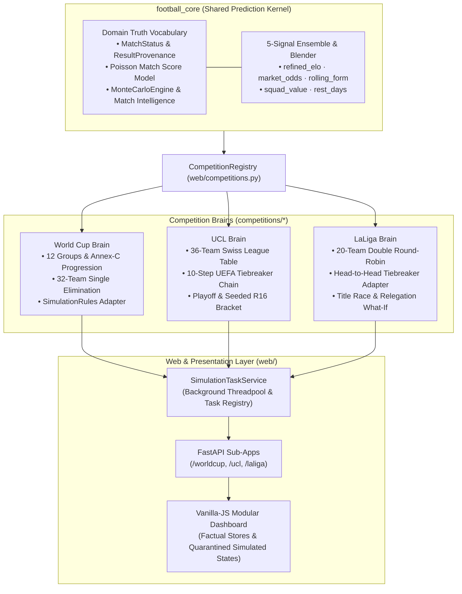

# FOOTBALL

[](https://football.iamsujoy004.workers.dev)
[](https://python.org)
[](https://fastapi.tiangolo.com)
[](#testing)
[](LICENSE)

A shared football prediction and Monte Carlo simulation engine with competition-specific brains — **World Cup 2026**, **UEFA Champions League 2026/27** (the active default, draw-derived; the 2025/26 season remains selectable as completed history), and **LaLiga EA Sports 2026/27** — where real played matches are immutable facts and every simulated outcome carries explicit mathematical provenance.


**Live Application:** [https://football.iamsujoy004.workers.dev](https://football.iamsujoy004.workers.dev) · **Edge Mirror:** [https://football.pages.dev](https://football.pages.dev) · **Quick Start:** [Setup](#setup)

## What it does

- **Ingests real football data** from external providers (football-data.org) into per-competition result stores, or runs entirely offline on verified committed snapshots with zero network calls. Bookmaker market odds are enriched separately via the optional `ODDS_PROVIDER` (The Odds API).
- **Produces match probabilities** from a canonical five-signal ensemble (`refined_elo · market_odds · rolling_form · squad_value · rest_days`) blended by one canonical `EnsembleEngine`, plus a bivariate Poisson score model driven by rating differences.
- **Simulates tournaments** through a generic Monte Carlo engine. Each competition supplies its own rules (groups, tiebreakers, knockout progression) behind a strict `SimulationRules` boundary; the shared engine owns validation (1..1,000,000 runs), seeded repetition, aggregation, and provenance.
- **Keeps truth explicit**: played matches are immutable facts that are never sampled; unplayed matches stay unknown until you explicitly request a simulation; simulated output is strictly quarantined from factual data and labeled everywhere it appears.

## Architecture



- **`football_core`** owns reusable football intelligence: the canonical
  truth vocabulary (`MatchStatus`, `ResultProvenance`,
  `DataAvailability`), signals and blending, the Poisson model, Elo math,
  the generic `MonteCarloEngine`, shared match-insight kernels, evaluation
  metrics, provider protocols, and atomic persistence. It imports nothing
  from the competition packages or the web layer.
- **Each competition brain** owns its format: World Cup has 12 groups,
  third-place qualification via the Annex-C table, and an R32-to-FINAL
  knockout with a third-place playoff; UCL has a 36-team Swiss league with
  the ten-step UEFA tiebreaker chain, a playoff round, and a
  data-driven knockout bracket; LaLiga is a 20-team double round-robin with a
  table-rules adapter. Each ships a `SimulationRules` adapter that realizes
  one tournament per call.
- **The web layer** owns discovery and orchestration only: an explicit
  `CompetitionRegistry` (the server's mounts derive from it), one
  `SimulationTaskService` for every background run, canonical lifecycle
  statuses, and truthful API payloads.

## Supported competitions

Implemented today:

| Competition | Format | Dashboard |
|---|---|---|
| World Cup 2026 | 48 teams, 12 groups, Annex-C third-place routing, R32..FINAL + third-place playoff | `/worldcup` |
| UEFA Champions League 2026/27 | 36-team Swiss league, draw-derived schedule pending/official enrichment, playoff round, seeded R16 bracket | `/ucl` |
| LaLiga EA Sports 2026/27 | 20-team double round-robin (380 fixtures, FDO-sourced), top-4 UCL / 5 Europa / 6 Conference / 18–20 relegation, MD6 postponed fixture carried to MD7 | `/laliga` |

The registry/adapter boundary is designed so future competitions (for
example Serie A) plug in by adding one competition brain and one
registry entry — no changes to `football_core`.

## Prediction & signals

Every match probability comes from the same pipeline: a `PredictionContext`
(Elo ratings, fixtures, played results) is evaluated by five signals whose
outputs are blended per outcome by `EnsembleEngine`.

| Signal | Source | Degrades to |
|---|---|---|
| `refined_elo` | context Elo ratings self-calculated (seed + local result replay via `football_core.elo_replay`) | 1500 default |
| `market_odds` | devigged bookmaker odds on ingested events | uniform thirds |
| `rolling_form` | recent results via a history provider | neutral form |
| `squad_value` | squad-value JSON (log-ratio transform) | median imputation |
| `rest_days` | fixture schedule gaps | assumes 7 days |

Cache-backed entries honor their own stored draw probability instead of any
hardcoded constant. Weights resolve as: explicit dict → committed
`config/signal_weights.json` → uniform fallback. Fitting uses inverse
multiclass log-loss only; UCL can fit calibrated weights from its results
history via `POST /ucl/api/calibrate` (output is gitignored runtime state),
while WC still ships uniform 0.2×5. No accuracy or ML claims are made —
evaluation metrics (Brier, log-loss, ECE, TRPS) exist but validated skill
claims do not.

## Simulation

Simulation is always user-triggered. Nothing runs automatically.

- Real played matches are immutable facts substituted verbatim in every
  iteration — never resampled, never overwritten.
- Only genuinely unresolved outcomes are eligible. A completed competition
  answers `not_needed`; missing required data fails honestly.
- Run count is validated between **1 and 1,000,000** (rejected, never
  clamped). Practical defaults: **WC 50,000** (bracket popup presets
  10K–500K; measured ≈26 s at 50K, ~5.7 s at 10K) and **UCL 5,000**
  (presets 1K/5K/10K/100K; measured ≈9 s engine time). Defaults were chosen
  for interactive response time; higher counts are available for deeper
  runs.
- An optional seed makes any run exactly reproducible; when omitted the
  engine generates one and returns it in the run metadata.
- Runs execute asynchronously with live progress polling and complete with
  a metadata block: `{status, count, seed, provenance}` where provenance
  asserts `real_results_preserved` and `simulated_matches_only`.
- Simulated output lives in separate stores (`sim_cache`,
  `snapshot.json`) and is rendered under explicit "SIMULATION" labeling;
  factual requests keep returning factual data afterwards.

## Data modes

Normal startup is fresh-first: the server attempts acquisition lazily per competition and falls back to the last validated stores on failure.
Fallback is reserved for real failures: if the provider answers HTTP 200 but has published zero matches for the active future season (UCL 2026/27), refresh reports `deferred/provider-empty` — not stale — and the committed draw-derived fixtures keep serving.
`FOOTBALL_DATA_ORG_KEY` is the match data provider credential (`DATA_PROVIDER=football-data`). Bookmaker odds are governed separately by `ODDS_PROVIDER`/`THE_ODDS_API_KEY` (see "Bookmaker odds"). Explicit snapshot/offline mode performs **zero** live requests — including
Elo lookups, which fall back to UEFA-coefficient-derived ratings for UCL —
and both dashboards disclose that stored data is being shown. A refresh
endpoint re-ingests live results into the canonical stores without touching
simulation state.

## Bookmaker odds

Market odds are a separate, optional enrichment layer — distinct from the
fixture/result feed:

- `DATA_PROVIDER` (football-data) → **fixtures and results**.
- `ODDS_PROVIDER` (the-odds-api | auto | none) → **bookmaker market
  odds** (1X2, decimal, vig-removed). Unset keeps each competition's legacy
  odds behavior; `none` disables odds
  enrichment explicitly. `auto` precedence is deterministic:
  **the-odds-api → none**, and the provider that actually supplied
  odds is reported in every odds summary.

Supported odds providers:

- **The Odds API** (`THE_ODDS_API_KEY`) — live market odds. Sport keys are
  mapped per competition (LaLiga `soccer_spain_la_liga`, UCL
  `soccer_uefa_champs_league`, World Cup `soccer_fifa_world_cup`).

Current provider capabilities (verified live):

| Competition | The Odds API odds | Consumption |
|---|---|---|
| LaLiga 2026/27 | **available** (real live fixtures mapped 20/20) | wired: The Odds API → canonical mapping → validation → de-vig → runtime odds store → `MarketOddsSignal` → `market_only` strategy |
| UCL 2026/27 | available in the live feed | **intentionally unchanged** — UCL still uses its existing odds path |
| World Cup 2026 | returns no usable events | unchanged — remains an odds-free competition |

The odds flow for LaLiga is: provider events → canonical fixture mapping
(folded team pair + kickoff date + home/away identity; unmatched or
flipped events are rejected, never guessed) → 1X2 validation → single-book
vig removal (`football_core.predictors.odds.remove_vig`) → runtime odds
store → `MarketOddsSignal` → signals blended by the ensemble, with
`market_only` selectable as an explicit strategy (candidate only — never
promoted).

**Freshness**: each record tracks `provider_last_update` (the bookmaker's
own timestamp, distinct from `fetched_at`); both must precede the match
kickoff. Post-kickoff provider updates are rejected as stale. A never-odds
match stays `MISSING`, not falsely `STALE`.

**Fallback**: missing, invalid, or stale odds remain honest
(`MISSING`/`INVALID`/`STALE`, never fabricated 0.0); `market_only` degrades
to uniform thirds when no valid odds exist; production weights and the rest
of the pipeline are unchanged.

**Security**: `.env` stays local and gitignored; API keys never appear in
source, tests, logs, or artifacts; redacted diagnostics only
(configured/status/counts, never the key).

## Performance

Measured on a mid-range laptop, single-threaded, current code:

| Competition | Count | Wall time | Where |
|---|---|---|---|
| World Cup | 10,000 | ~5.7 s | engine |
| World Cup | 1,000,000 | ~682 s (~11 min) | engine, executed end-to-end |
| UCL | 5,000 (default) | ~9.3 s engine / ~12 s served | served incl. polling |
| UCL | 10,000 | ~18.6 s engine / ~20.5 s served | served incl. polling |

Stability observation at fixed seed: UCL top-5 membership and order are
identical between 5,000 and 10,000 runs (max champion-probability delta
0.0047). This is a sampling-stability observation, not a convergence proof.

## Setup

```bash
pip install -r requirements.txt

cp .env.example .env    # optional: FOOTBALL_DATA_ORG_KEY for live fixtures,
                        # and ODDS_PROVIDER/THE_ODDS_API_KEY for bookmaker odds

python -m web.server    # http://127.0.0.1:8080
# explicit offline mode: python -m web.server --offline

python -m pytest        # run the test suite
```

Without API keys the server falls back to validated local data; both dashboards render. Use `--offline` (or `FOOTBALL_SNAPSHOT=1`) when you explicitly require zero network activity.

## Fresh checkout (bootstrap)

The repo commits **seed data only** — no runtime stores. On a fresh clone:

```bash
# 1. Materialize the UCL runtime stores from tracked bootstraps
python -m competitions.ucl.backfill        # writes knockout_results.json (KO history)
python -m competitions.ucl.backfill --league  # writes results.json (league results)
```

The bootstrap files in `competitions/ucl/data/bootstrap/` are tracked:
- `2025_26_knockout_results.json` — v1 historical aggregates (git 7cbc0f6)
- `league_results_2025_26.json` — full 144-match league ledger

The UCL 2026/27 season needs no bootstrap step: the tracked
`draws/2026_27_league_draw.json` self-materializes into `seasons/` at server
boot (`web/server.py:_ensure_ucl_default_season`) when no season pointer
exists, so a fresh clone boots the 2026/27 default with zero manual steps.

Runtime stores (`results.json`, `knockout_results.json`, `snapshot.json`,
and future `seasons/` directories) are **gitignored** — they are generated
artifacts, not source of truth. Tests that need complete stores use
`tests/ucl_bootstrap.make_ucl_runtime_dir(tmp_path)` or the
`ucl_runtime_dir` pytest fixture in `competitions/ucl/tests/conftest.py`.

## Testing

The test suite covers algorithmic kernels, probabilistic invariant contracts, cross-competition state schemas, and end-to-end browser workflows:

```bash
# 1. Run complete Python test suite (2,339 tests)
python -m pytest

# 2. Run in explicit offline snapshot mode
FOOTBALL_SNAPSHOT=1 python -m pytest

# 3. Run frontend lifecycle & timer unit tests (25 tests)
node --test web/static/refresh.test.mjs

# 4. Run Playwright headless browser E2E tests (5 tests)
python -m pytest tests/test_e2e_browser.py
```

### Verified Suite Results

| Test Layer | Framework | Count | Status | Description |
|---|---|---|---|---|
| **Prediction Kernel & Competitions** | pytest | 2,339 | **Passing** | Mathematical contracts, Poisson models, Elo replay, Monte Carlo reproducibility, Swiss tiebreakers, Annex-C logic. |
| **Frontend Lifecycle & Timers** | node:test | 25 | **Passing** | Document visibility, timer coalescing, tab switching, stale generation tokens, honest UI fallback banners. |
| **Headless Browser E2E** | Playwright Chromium | 5 | **Passing** | Real browser rendering, tournament switching, multi-view DOM transitions, and simulation reactivity. |

## Known limitations

- WC knockout win probabilities use matchup-aware Elo rather than the full
  ensemble (bracket slots have no team identity until resolved).
- Mid-tournament WC bracket slot occupants come from a deterministic
  projection and are not labeled per-node yet.
- Simulations cannot be cancelled; progress polling is one-shot after a
  terminal state.
- UCL Elo with no usable seed falls back to UEFA-coefficient-derived ratings.
- UCL 2026/27 Elo coverage is measured, not assumed: all 36 draw team ratings
  are self-calculated at runtime — the committed seed snapshot plus a
  chronological replay of locally stored played results dated strictly after
  the seed's as-of (`football_core.elo_replay`). Sessions whose seed cannot
  resolve every fixture team degrade to the coefficient fallback for the whole
  set; never a partial mix or a fabricated fill. `competitions/ucl/data/
  team_aliases.json` and the fixtures' `clubelo_name` fields live on as
  committed identity data. The UI renders coverage and provenance instead of
  implying full coverage.
- No accuracy/skill claims: labeled history is still accumulating.

## Project structure

```text
football_core/            shared kernel: domain truth model, signals +
                          ensemble, Poisson model, MonteCarloEngine,
                          shared insight, Elo infra, generic odds-provider
                          layer (contract, The Odds API adapter,
                          acquisition core), providers, persistence
competitions/worldcup/    WC brain: groups/Annex-C/knockout rules,
                          SimulationRules adapter, engine/pipeline,
                          signal caches, benchmark, tests
competitions/ucl/         UCL brain: Swiss/playoff/bracket rules,
                          SimulationRules adapter, orchestrator/pipeline,
                          calibration, bootstrap CIs, tests
competitions/laliga/      LaLiga brain: round-robin + table rules,
                          simulation, odds ingestion adapter, tests
web/                      CompetitionRegistry, SimulationTaskService,
                          startup flow, FastAPI sub-apps, vanilla-JS SPA
tests/                    cross-cutting regression suites (truth model,
                          engine contract, immutability, product contract)
docs/                     ARCHITECTURE.md, GETTING-STARTED.md, TESTING.md
```

## License and Attribution

This project's original source code is released under the [MIT License](LICENSE) © 2026 Sujoy.

### Scope and Exclusions

The MIT license covers original prediction algorithms, simulation engines, orchestration pipelines, and web application code. It explicitly excludes and does not grant rights to:

- **Third-Party Web Fonts (`web/static/fonts/`):** Space Grotesk, Manrope, and JetBrains Mono are distributed under the [SIL Open Font License 1.1](web/static/fonts/OFL.txt).
- **Sports Data & Fixtures (`competitions/*/data/`):** Historical results and backfill corpora are compiled from public domain sources (openfootball under CC0-1.0), research archives (football-data.co.uk per academic use terms), API-Football closing odds (CC-BY-4.0), and ClubElo mirrors (MIT).
- **External API Data:** Real-time fixture, score, and market odds data accessed via Football-Data.org and The Odds API remain governed by their respective API terms of service.
- **Trademarks & Competition Marks:** Competition names (FIFA World Cup, UEFA Champions League, LaLiga EA Sports), club names, and badges are property of their respective trademark holders. This project is unofficial and unaffiliated with FIFA, UEFA, or LNFP.

