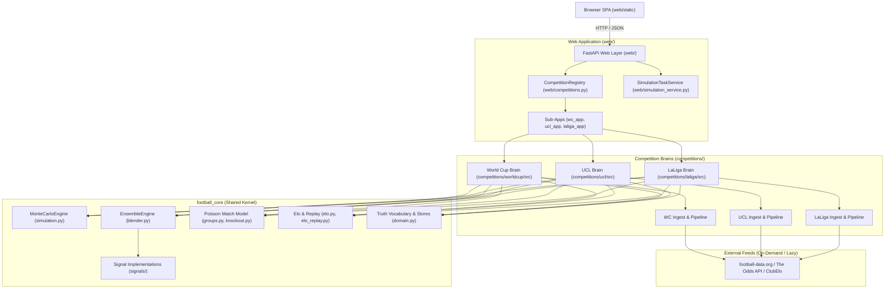

# ARCHITECTURE

## Overview

```text
Elo ratings (self-calculated seed+replay kernel + eloratings.net offline sync)
        ↓
5-signal refinement ensemble          refined_elo · market_odds ·
(EnsembleEngine, weighted blend)      rolling_form · squad_value · rest_days
        ↓
Match probabilities  (Poisson score model driven by rating difference)
        ↓
MonteCarloEngine (football_core)      ← validation · seeded RNG · N runs ·
        ↓                                aggregation · SIMULATED provenance
SimulationRules (one adapter per competition brain)
        ↙                    ↘               ↘
World Cup 2026          UCL 2026/27     LaLiga 2026/27
  12 groups +            Swiss league +   20-team
  Annex-C + TPP          playoff +        round-robin
                         seeded R16       + table rules
                         ↳ 2025/26 retained as historical
        ↘                    ↙
CompetitionRegistry ── FastAPI shell ── dashboard
```

## Layer responsibilities

| Layer | Owns | Must never do |
|---|---|---|
| `football_core` | signals, blending, Poisson model, generic MC engine, canonical domain/truth vocabulary, shared insight | import competitions/* or web/*; know any format |
| Competition brains (`competitions/<id>/`) | rules, standings, tiebreakers, fixture interpretation, progression, champion determination, phase derivation | be imported by football_core |
| Web layer (`web/`) | registry/adapter discovery, simulation task orchestration, truthful API payloads, static shell | encode tournament logic; fabricate state |

## football_core (shared kernel)

| Module | Responsibility |
|---|---|
| `football_core/domain.py` | Canonical truth vocabulary: `MatchStatus`, `ResultProvenance`, `DataAvailability`; `CanonicalMatch`; store-availability loader |
| `football_core/simulation.py` | `MonteCarloEngine` (run-count validation 1..1,000,000, isolated seeded RNG, repetition via `SimulationRules.simulate_one`, declared aggregations, fail-fast), `SimulationRequest`/`SimulationResult`, provenance guards |
| `football_core/insight.py` | Shared match intelligence: form trend, head-to-head, outcome distribution, insight text, KO signal ratio blend |
| `football_core/signal.py` | `Signal` protocol, registry, `PredictionContext` |
| `football_core/blender.py` | **The** ensemble: `EnsembleEngine`, `compute_log_loss_weights`, `compute_signal_contributions`. Nothing else. |
| `football_core/signals/` | The five signal implementations (+ `cached.py` cache-backed signal honoring stored draw probabilities) |
| `football_core/groups.py` | Poisson match model: expected goals from rating diff, cached CDF sampling, played-result injection, league-format sampler, tiebreaker chains |
| `football_core/knockout.py` | Knockout primitives: single match (+ET/pens), two-legged ties, blended-prob resolution with matchup-aware Elo fallback |
| `football_core/elo.py` / `football_core/elo_replay.py` / `football_core/elo_sync.py` | Elo math; competition-agnostic seed+replay kernel (reuses `update_ratings`/`compute_k_factor`; offline); eloratings.net TSV sync with graduated correction |
| `football_core/predictors/odds.py` | Single-book devig (`remove_vig`) — the canonical vig-removal math |
| `football_core/odds.py` | Generic live market-odds layer: `OddsProvider` contract, `TheOddsApiOddsProvider`, `ODDS_PROVIDER` resolution (the-odds-api/auto/none), deterministic primary-book selection, canonical acquisition core (fixture mapping, validation, freshness, state, store), observability. Data provider (`DATA_PROVIDER`) stays fixtures/results-only |
| `football_core/data_providers/` | football-data.org result/event provider (`fetch_matches` only) |
| `football_core/evaluation.py` | Brier, log-loss, ECE, calibration curve, TRPS (numpy only here) |
| `football_core/state.py` | Atomic JSON persistence helpers; bracket DAG validation (`validate_bracket`) |
| `football_core/provider.py` | Protocols: `DataProvider`, `FixtureProvider`, `MatchResultProvider`, `ResultHistoryProvider` |
| `football_core/fetcher.py` | Alias normalization, ingestion-stat counters/invariant, `IngestReport` (competition-agnostic refresh report shape) |

## Data acquisition & competition ingestors (Exchange 6)

Acquisition policy: normal `python -m web.server` is fresh-first and
competition-scoped, but provider calls are lazy — each competition attempts its
own provider on its first data request (or through the optional eager preload).
A failed attempt falls back to the last validated on-disk stores and the UI
reports FALLBACK/stale state with the error. Explicit offline execution
(`FOOTBALL_SNAPSHOT=1` or `python -m web.server --offline`) performs zero
network calls. Placeholder credentials select no provider. A failed scrape
never mutates factual stores.

Transport selection is shared (`web/common.get_data_provider`: football-data.org, chosen by keys/`DATA_PROVIDER`); everything after raw
events is competition-owned. Each brain exposes its own authoritative ingest
path — World Cup: `competitions/worldcup/src/pipeline.fetch_live_data`; UCL:
`competitions/ucl/src/pipeline.fetch_live_data`, which routes new-season
events through the multi-season store. The web layer never parses competition
events;
it selects the provider, hands it to the brain, and is the SINGLE writer of
its freshness entry in `web/last_refresh.json` from the returned
`IngestReport`.

The UCL ingestor can CREATE knockout records, not only update them: with an
empty store it derives tie skeletons deterministically from final Swiss
standings + `competitions/ucl/data/playoff_pairings.json` + `competitions/ucl/data/bracket_rules.json`, persists
individual legs plus ET/penalty detail, cascades winners into downstream
slots via `source_matches`, and resolves the champion. It is idempotent and
writes stores atomically. `competitions/ucl/backfill.py` is an explicit
one-shot command that bootstraps the verified historical 2025/26 knockout
dataset (tracked at `competitions/ucl/data/bootstrap/2025_26_knockout_results.json`,
extracted byte-identically from git history; provenance `manual`) — it is
never executed by server startup.

Live feed status (verified against football-data.org): a fetch of the
finished 2025/26 season returns 189 matches, cross-checks the committed
history, and the historical bootstrap guarantees factual completeness
offline regardless. The provider is season-aware — the UCL ingestor passes
the requested season explicitly
(`football_core/data_providers/football_data_org_provider.py`), so a future
season can never silently serve the prior season's data.

Future-season provider-empty / deferred state: when the active season is
non-historical (UCL 2026/27), football-data.org answers HTTP 200 but has
published zero finished matches. `competitions/ucl/src/pipeline.py` records
this as a **deferred** refresh (`deferred: True`, `reason: "provider_empty"`,
`stale: False`) — an honest "not published yet" outcome, explicitly distinct
from a transport/provider failure (which sets `last_error` and reports
stale). The provider was reachable and answered authoritatively; nothing has
been published for that season yet. The draw-derived 2026/27 fixtures in the
committed store remain authoritative and keep serving until live result data
is published, and the UI labels the state accordingly rather than showing
fallback/stale.

### Bookmaker market odds (`ODDS_PROVIDER`)

Market odds are enriched separately from fixtures/results. `DATA_PROVIDER`
selects the fixture/result feed; `ODDS_PROVIDER` selects the odds source:

- `the-odds-api` — live market odds through
  `football_core.odds.TheOddsApiOddsProvider` (official v4 `/v4/sports/{sport}/odds/`,
  h2h, decimal, EU books; sport keys per competition in `SPORT_KEYS`).
- `auto` — **the-odds-api → none** (deterministic). The acting
  provider is reported in the odds summary, never inferred later.
- `none` — explicit disable.

Book selection is deterministic and documented: primary book (`pinnacle`
by default) when it carries a complete h2h set, else the most-recently
updated book, ties broken lexically. No multi-book averaging. Prices are
matched by folded team name, never by outcome ordering. Providence per
record: `provider`, `bookmaker`, `provider_event_id`, `provider_last_update`,
`fetched_at`, `event_kickoff`, `provenance`.

Capabilities (verified live, Phase 13B): LaLiga 2026/27 maps **20/20** real
The-Odds-API events onto canonical fixtures with real non-uniform odds; UCL
feed availability is verified but UCL consumption is intentionally
unchanged; World Cup returns no usable events through The Odds API and stays
odds-free.

### CompetitionState & shared bracket contract

Each brain emits one structural state object that both factual and simulated
views share:

```text
CompetitionState = {competition, season, mode, phase, availability,
                    champion, stage_order, stages}
stage  = {id, label, layout: tree|list, matches|matchdays}
UCL tie= {id (canonical, from bracket_rules.json), round, team_a/b,
          legs[], aggregate_a/b, et_*, penalties_*, winner,
          status (MatchStatus), provenance (ResultProvenance),
          slot_sources, source_matches}
```

- UCL builder: `competitions/ucl/src/state.py::build_competition_state`
  (`mode="results"` reads canonical stores; `mode="simulation"` flattens a
  simulation payload onto the identical shape with `provenance="simulated"`).
- WC serves its validated DAG skeleton ⊕ results overlay per node with
  status/provenance and declares `stage_order`/`stage_labels`.
- Structural integrity is checked by `football_core.state.validate_bracket`
  (unique ids, resolvable parent refs, acyclic).

Frontend: `shared.js::renderBracketTree(container, bracketState, adapter)`
is the single generic renderer (columns, leaf-order spacers, SVG connectors
via parameterized `drawBracketConnectors`, SIM/MAN provenance badges). It
contains no competition vocabulary — labels, ordering, two-leg formatting
and click behavior come from thin per-app adapters (`wc.js`, `ucl.js`). UCL
two-legged ties render LEG 1 / LEG 2 / AGGREGATE (+ET/PENS notes); the
playoff stage stays a list layout ahead of the R16→FINAL tree.

## Simulation contract

- The user chooses whether to simulate and how many runs (1 .. 1,000,000;
  validated, never clamped).
- A seed may be supplied; when omitted the engine generates one and returns
  it in metadata, so every run is reproducible.
- Each competition implements `SimulationRules`: `simulate_one(context)`
  realizes one complete tournament from an engine-owned isolated RNG,
  treating real results as immutable facts. Real matches are substituted
  verbatim — never sampled.
- Aggregation is schema-free: rules declare counter objects; the engine
  aggregates summaries without storing tournament states.
- Every output carries SIMULATED provenance; a failure aborts the whole run
  (no partial results).

## Truth model

Played matches are immutable facts. Unplayed matches stay unknown until the
user explicitly requests a simulation. Simulated output is labeled as such
and lives in separate stores (`sim_cache`, `snapshot.json`) — it can never
overwrite canonical data. Missing required data is reported unavailable;
it is never represented as 0.0 or fabricated fixtures.

Season lifecycle (Exchange 3) is discovered per competition, never
hardcoded: each brain derives `stage` (completed / active / future /
unknown), progress and historical seasons from on-disk evidence (UCL:
`src/lifecycle.py::discover`; WC: `season_lifecycle`), optionally
cross-checked against provider-declared seasons and explicit current-season
pointers; a valid newer season can become active without overwriting history. Lifecycle drives UX: completed seasons
render facts only — no season-wide Monte Carlo controls; per-match/tie
What-If remains available through Match Intelligence and is always labeled
SIMULATED with the factual history unchanged. Active seasons expose
"X played / Y remaining" and simulate only unresolved matches. Overview
probability tables are labeled "Monte Carlo aggregate over N runs"; any
sampled realization shown in a bracket is labeled "example simulated
bracket (one sampled run)".

Lifecycle states exposed by both competitions: `not_requested`,
`running`, `completed`, `not_needed`, `unavailable`, `failed`,
`validation_error`.

Fixture identity is a separate contract: each competition derives its own
fixture id, the three signatures are deliberately not unified, and the
World Cup has none. See `docs/FIXTURE-IDENTITY.md`.

## Web layer

- `web/competitions.py` — explicit `CompetitionRegistry`. Each adapter
  exposes id/metadata, its FastAPI sub-app, `get_status()` and
  `simulation_support()`. Adding a competition = adding one adapter here.
- `web/simulation_service.py` — one task registry/thread lifecycle for all
  simulations and calibrations, plus the shared status vocabulary and
  completed-run metadata block.
- `web/wc_app.py`, `web/ucl_app.py`, `web/laliga_app.py` — HTTP +
  presentation-compute adapters over each brain's compute functions (format
  rules stay in the brains).

## Signals

| Signal | Data source | Degradation |
|---|---|---|
| `refined_elo` | context Elo ratings self-calculated (seed + local result replay) | defaults to 1500 |
| `market_odds` | devigged bookmaker odds from the live odds provider (`ODDS_PROVIDER`: The Odds API) | uniform thirds |
| `rolling_form` | recent results via a result-history provider | neutral form |
| `squad_value` | committed squad-value JSON (log-ratio sigmoid); path injected by the owning competition | uniform thirds |
| `rest_days` | fixture schedule gaps | assumes 7 days rest |

World Cup additionally carries its own live-synced `elo` signal as base;
UCL's base rating enters through `refined_elo`.

## Weight resolution & calibration

Precedence everywhere: explicit weights dict → committed
competition weights (e.g., `competitions/worldcup/config/signal_weights.json` or `competitions/laliga/config/signal_weights.json`) → **uniform fallback** (logged).

Fitting uses one method only: inverse multiclass log-loss
(`compute_log_loss_weights`, floored at 0.05, normalized). Entry points:
`POST /worldcup/api/calibrate` (fits on recorded prediction history) and
`POST /ucl/api/calibrate` (fits on replay/results data). Both write provenance
(`method`, `source`, `n_matches`) and refuse to fit below the per-signal
sample threshold.

**Current status:** World Cup ships and runs the uniform fallback. UCL fits
calibrated inverse-log-loss weights from its results history at runtime when
`competitions/ucl/config/signal_weights.json` is present (gitignored runtime
output of `POST /ucl/api/calibrate`; regenerate it any time). Out of the box
both competitions start uniform. No *validated accuracy* claims are made —
only that the fitting procedure and its provenance exist.

## Reproducibility & performance

Simulations accept an optional seed; when omitted the engine generates one
and returns it in the run metadata, so any run can be replayed exactly.
Identical code + data + seed + count ⇒ identical aggregates. UCL runs add
bootstrap/Wilson confidence intervals on championship probabilities.

Measured on a mid-range laptop (single thread): World Cup ~5.7 s at 10,000
runs (~26 s at its 50,000 default preset) and UCL ~9.3 s engine time at its
5,000 default (~12 s served including polling). WC sustains ~1,500
iterations/s and has been executed end-to-end at the full maximum of
1,000,000 runs (~11 minutes); that 1M datapoint predates the shipped
benchmark harness, which caps at 100K. Higher counts remain available for
deeper runs.

## Known limitations

- WC knockout win probabilities come from matchup-aware Elo rather than the
  full ensemble (bracket slots have no team identity until resolved).
- Mid-tournament, WC bracket slot occupants for unplayed group positions
  are projections from a deterministic seed-0 re-simulation; they are not
  labeled per-node in the UI yet.
- Snapshot mode is fully offline except that it never refreshes live data;
  UCL Elo falls back to UEFA-coefficient-derived ratings offline.
- No cancellation of running simulations; polling is one-shot after a
  terminal state by design.

## Component diagram



## Data flow

A typical request through the platform follows one of two primary execution paths:

### 1. Primary Request Path (Data / State Ingestion and API)
1. **Client Request**: Browser SPA queries a competition endpoint (e.g., `GET /ucl/api/data` or `POST /ucl/api/refresh`).
2. **Web Routing & Middleware**: Handled in `web/server.py` via ASGI middleware `no_store_for_competition_api`, which applies `Cache-Control: no-store`. Routed to the competition sub-app (`web/ucl_app.py`) via `CompetitionRegistry`.
3. **Data Acquisition (Lazy / On-demand)**:
   - On explicit refresh (`POST /api/refresh`) or first lazy read in a process, `adapter.refresh()` delegates to the competition pipeline (`competitions/ucl/src/pipeline.py::fetch_live_data`).
   - If offline mode is enabled (`FOOTBALL_SNAPSHOT=1`), network calls are bypassed and local stores are loaded directly.
   - Provider responses (from `football-data.org`) are ingested and parsed strictly into canonical factual stores (`competitions/ucl/data/`). An `IngestReport` is recorded in `web/last_refresh.json`.
4. **State Building**:
   - `competitions/ucl/src/state.py::build_competition_state` reads validated on-disk stores (`canonical_matches.json`, Swiss standings, knockout records).
   - Generates a structural `CompetitionState` dictionary containing stages, fixtures, ties, status (`MatchStatus`), and provenance (`ResultProvenance.FACTUAL`).
5. **Response Delivery**: Served as JSON payload to the client without mutating canonical facts.

### 2. Simulation Request Path (Monte Carlo Execution)
1. **Simulation Dispatch**: Client posts a request (`POST /ucl/api/simulate`) with `n_simulations` (1 to 1,000,000) and optional `seed`.
2. **Task Registration**: Handled by `SimulationTaskService` (`web/simulation_service.py`), which allocates a thread task, tracking status (`running`, `completed`, `failed`).
3. **Engine Invocation**:
   - Spawns `MonteCarloEngine.run(request)` in `football_core/simulation.py`.
   - Initializes an isolated, reproducible random number generator (`random.Random(seed)`).
4. **Per-Iteration Execution (`SimulationRules.simulate_one`)**:
   - The competition's specific rules (`competitions/ucl/src/simulation.py`) execute one complete tournament pass.
   - Real, played matches are treated as immutable facts and injected verbatim with factual provenance.
   - Unplayed matches are sampled via the Poisson model driven by ratings from `EnsembleEngine` (blending active signals: Elo, rolling form, squad value, rest days, market odds).
5. **Aggregation & Output**:
   - Outcomes (stage reach probabilities, qualification rates, title odds) are aggregated incrementally into statistical counters without holding tournament states in memory.
   - Resulting summary is tagged with `ResultProvenance.SIMULATED` and returned to `sim_cache`.
   - Browser client polls `/api/simulation` until complete, rendering projected outcomes alongside factual data.

## Key abstractions

The core interfaces, data models, and contracts governing the codebase include:

- [`CanonicalMatch`](file:///C:/Users/KIIT0001/Documents/projects/FOOTBALL/football_core/domain.py#L104): Unified representation of a match across all stages and sources, enforcing immutable status (`MatchStatus`) and explicit provenance (`ResultProvenance`).
- [`MonteCarloEngine`](file:///C:/Users/KIIT0001/Documents/projects/FOOTBALL/football_core/simulation.py#L140): Generic, competition-agnostic Monte Carlo engine executing validated simulation iterations with isolated seeded RNG and declared aggregations.
- [`SimulationRules`](file:///C:/Users/KIIT0001/Documents/projects/FOOTBALL/football_core/simulation.py#L42): Protocol defining competition-specific tournament logic; requires implementing `simulate_one(context)` and declaring aggregation collectors.
- [`Signal`](file:///C:/Users/KIIT0001/Documents/projects/FOOTBALL/football_core/signal.py#L34): Protocol defining pluggable match predictor signals (`name`, `predict(match, context) -> SignalOutput`).
- [`SignalRegistry`](file:///C:/Users/KIIT0001/Documents/projects/FOOTBALL/football_core/signal.py#L60): Registry managing active signals with graceful fallback mechanisms during partial evaluation failures.
- [`EnsembleEngine`](file:///C:/Users/KIIT0001/Documents/projects/FOOTBALL/football_core/blender.py#L74): Blends probabilities from multiple signals using normalized inverse log-loss weighting.
- [`CompetitionAdapter`](file:///C:/Users/KIIT0001/Documents/projects/FOOTBALL/web/competitions.py#L74): Boundary abstraction connecting the shared web shell to competition sub-apps, managing status, simulation lifecycle, and scoped refresh hooks.
- [`SimulationTaskService`](file:///C:/Users/KIIT0001/Documents/projects/FOOTBALL/web/simulation_service.py#L45): Thread lifecycle manager and task registry for asynchronous simulations and calibrations.
- [`DataProvider`](file:///C:/Users/KIIT0001/Documents/projects/FOOTBALL/football_core/provider.py#L25): Structural protocol for external sports data fetchers providing fixtures and match results.
- [`OddsProvider`](file:///C:/Users/KIIT0001/Documents/projects/FOOTBALL/football_core/odds.py#L27): Protocol defining live market odds acquisition, devigging, and bookmaker selection.

## Directory structure rationale

The top-level codebase layout separates the shared kernel, autonomous tournament brains, and web delivery:

```text
FOOTBALL/
├── football_core/      # Shared prediction kernel: domain vocabulary, Monte Carlo engine, signals, Elo math, and blender
│   ├── data_providers/ # Generic external API clients (football-data.org)
│   ├── persistence/    # Atomic store persistence routines
│   ├── predictors/     # Odds devigging algorithms
│   └── signals/        # Signal protocol implementations (refined_elo, rolling_form, squad_value, rest_days, market_odds)
├── competitions/       # Autonomous tournament brains; each owns its format, progression rules, and pipelines
│   ├── worldcup/       # World Cup 2026: 12-group format, Annex C tiebreakers, third-place ranking, 32-team knockout DAG
│   ├── ucl/            # UEFA Champions League 2026/27: 36-team Swiss phase, knockout playoff, seeded R16 bracket
│   └── laliga/         # LaLiga 2026/27: 20-team double round-robin, H2H tiebreakers, relegation/European spots
├── web/                # HTTP presentation layer, FastAPI server, competition adapters, and simulation service
│   ├── derived/        # State snapshot holding and race-free state publication
│   └── static/         # Vanilla JavaScript single-page application (SPA) dashboard, styles, and assets
├── tests/              # Test suites (unit, integration, contracts, and architecture tests)
├── docs/               # System documentation, architectural decisions, and operational guides
└── scripts/            # Utility and maintenance scripts (backfills, benchmarks, validations)
```

